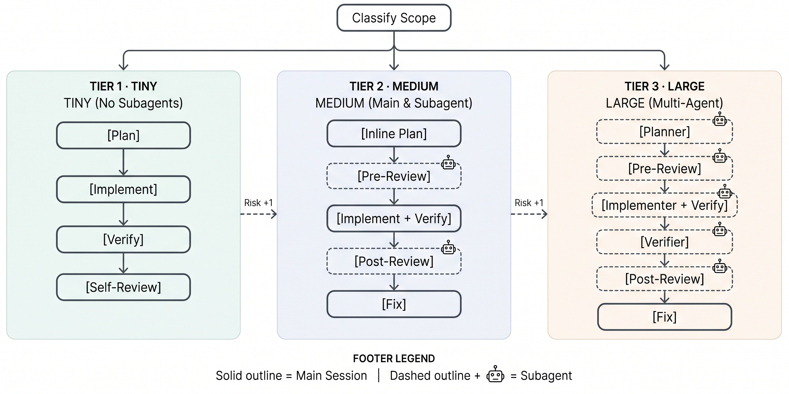

<div align="center">
  
  <h3><strong>Light RIP</strong></h3>
  <p>Plan · Implement · Review</p>
  <hr />
  <br /><br />
  
  <br /><br />
</div>

## Introduction

Light RIP is an agent skill package, not a software application.

`RIP` names the three safeguards: `Review`, `Implement`, and `Plan`. In execution, every tier runs `Plan -> Implement -> Review` — a lightweight loop with extra review passes for medium and large.

- **`Tiny`**: the main session plans, implements, verifies, and self-reviews. No subagents.
- **`Medium`**: the main session writes an inline plan; a reviewer subagent does a pre-work review; the main session implements and verifies; the reviewer (or a fresh one) does a post-work review of the diff; the main session fixes findings.
- **`Large`**: a planner subagent produces the plan; a reviewer subagent does a pre-work review; an implementer subagent implements and self-verifies; a verifier subagent independently re-runs verification; the reviewer (or a fresh one) does a post-work review of the diff and verification output; the main session coordinates and fixes findings.

## Reviewer and verifier roles

Light RIP uses three independent subagent roles in Medium and Large:

- **Pre-work reviewer**: scrutinizes the plan before any code is written. Catches wrong target files, wrong abstractions, missing verification, and misread requirements.
- **Implementer (Large only)**: does the work and runs the planned verification commands itself.
- **Verifier (Large only)**: independently re-runs the verification commands with fresh eyes, so verification is not single-sourced.
- **Post-work reviewer**: scrutinizes the diff and verification output after implementation. Catches bugs, regressions, transcript contamination, and risky overengineering.

Risk upgrades the tier: risky tiny becomes medium; risky medium becomes large.

P0/P1 findings from any reviewer or verifier pass block completion. The main session fixes them; for Large, the main session may route verifier fixes back through the implementer for fix + self-verify + verifier re-run. Relevant verification runs again, and nontrivial P1 fixes get a short re-review.

## Installation

Copy and paste this prompt into your coding agent:

```text
Install the Light RIP skill from https://github.com/x1han/light-rip: first detect which agent harness you are running in and clone the repo into that harness's skills directory (~/.claude/skills/light-rip for Claude Code, ~/.codex/skills/light-rip for Codex, ~/.gemini/config/skills/light-rip for Antigravity, or your harness's skills folder). If you are Claude Code, Codex, or Antigravity, run `python hooks/install_hook_based_harness.py install --runtime <claude|codex|antigravity>` from inside the cloned folder and verify with `python hooks/verify_install.py --runtime <runtime>`. If you are any other harness (such as ZCode, OpenCode, Cursor, etc.), first inspect your own harness's hook or prompt-injection mechanism, study `hooks/install_hook_based_harness.py` and `hooks/light_rip_reminder.py` to see how Claude Code, Codex, and Antigravity are adapted, propose the cleanest adaptation plan for your harness, and ask me for confirmation before modifying any config files.
```

### Supported harnesses

| Harness | Skills dir | Hook mechanism | Installer |
| --- | --- | --- | --- |
| **Claude Code** | `~/.claude/skills/light-rip` | `UserPromptSubmit` (`~/.claude/settings.json`) | `python hooks/install_hook_based_harness.py install --runtime claude` |
| **Codex** | `~/.codex/skills/light-rip` | `UserPromptSubmit` (`~/.codex/hooks.json` + `~/.codex/config.toml`) | `python hooks/install_hook_based_harness.py install --runtime codex` |
| **Antigravity** | `~/.gemini/config/skills/light-rip` | `PreInvocation` (`~/.gemini/config/hooks.json`) | `python hooks/install_hook_based_harness.py install --runtime antigravity` |
| **Other** (ZCode, OpenCode, …) | harness skills dir | Inspected per harness | `python hooks/install_general_harness.py` (evaluates & asks before writing) |

> **Note for Codex**: `install --runtime codex` requires `tomli_w` (`pip install tomli-w`; on Python < 3.11 also `pip install tomli`). Claude Code and Antigravity require only the Python standard library.
